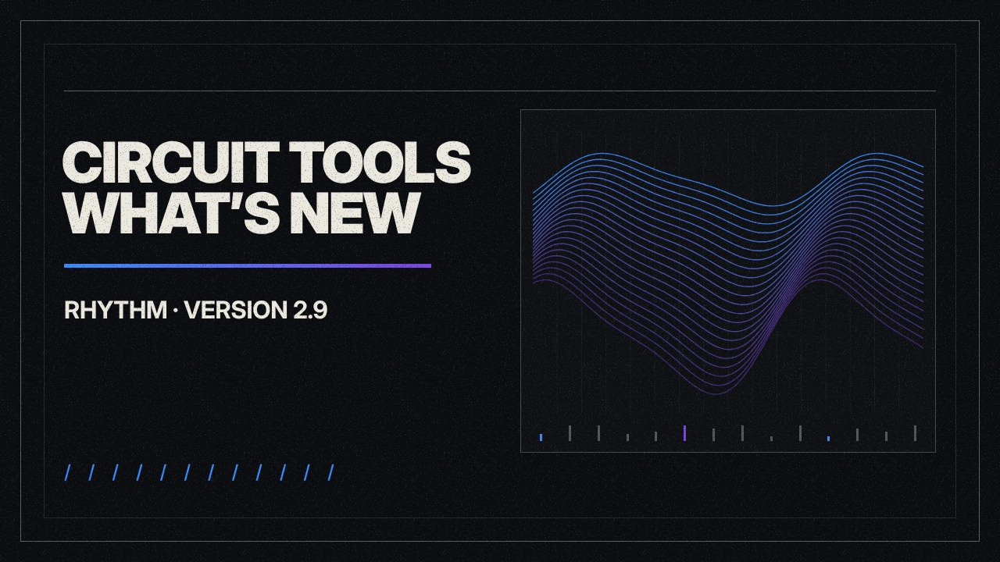
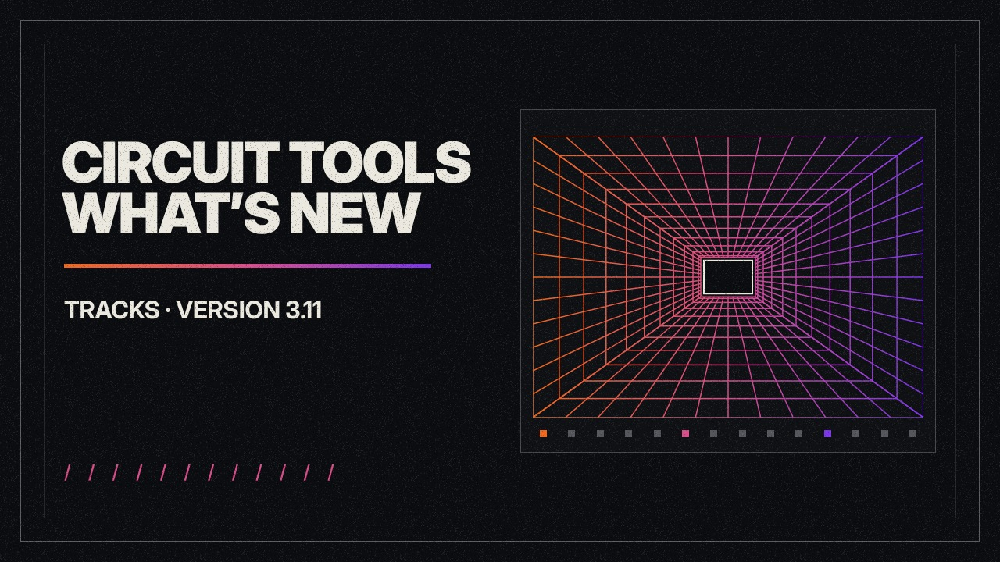

# Changelog

What changed in each version. The current builds are in each tool's `dist/` folder; `SHA256SUMS.txt` lists their checksums. Back to the [README](README.md).

## Circuit Rhythm · Sample Library / Pack Builder

### 2.9 · 23 Nov 2026

- **One sample, one folder.** What plays and the type decide the folder. A hi-hat loop is always `14 Drum Loops / Closed-Hats`, whether you press H, pick the subfolder or switch the type with W.
- **Batch export with your cuts.** The whole library, the filtered list or a selection, sorted into folders: as is, like the original with your cuts (trim, fit to bar, shortened loops; same sample rate, channels and bit depth) or for the Rhythm.
- **Slices in the original format.** Loops can come out in 2–16 slices, each loop in its own folder.

### 2.8

- **Mono that repairs.** A stereo sample that cancels when summed is fixed for the Rhythm (inverted channel, channels a few ms apart, or a frequency-aligned sum). Your file and anything exported "as the original" stay in stereo.
- 2.8.1: links to the source code and to Issues in the footer and in *About*.

### 2.7

- **Slices, separately.** The slices you keep from a shortened loop can come out as separate, linked samples (the loop, the loop with the fill…), on adjacent pads.

### 2.5 – 2.6

- A drum loop's subfolder says what plays in it (Closed-Hats, Shakers, Perc…).
- Each detected clue is one click away; copy and paste category, type, subfolder and tags.
- *Saved in* shows the exact folder that *Organise on disk* will create. Consistent folder names.

### 2.3 – 2.4

- **Work the sound.** Hits from a loop, tuning to the key of the pack and perceived loudness matched page by page.
- Tag clipboard (Alt Shift V / Alt V).

## Circuit Tracks · Patch Library / Editor

### 3.11 · 27 Nov 2026

- **Every patch in its register.** The test phrase moves by whole octaves so each patch sounds where the rest of its group does (or, if you prefer, plays the group's phrase as on the Circuit). When a patch sits an octave away from its group, the tool says so and fixes it with one click.
- **The phrase stops when you move on.** Esc, the next patch, the second half of an A/B, a macro sweep, a looping pattern or a song: whatever was still queued no longer reaches the unit. New *loop* option while you listen.
- **Copy the folder with the tags.** Shift V copies a patch's folder and tags, V pastes them; each part can be switched off. Each patch shows where *Sort on disk* will save it, and *Sort on disk* can work on just the selection.
- Measurements belong to the sound that was measured: after an octave fix, the old one no longer counts.

### 3.10 · 22 Nov 2026

- **One sound, one version.** What you edit adds up in a single version per sound; the original is always kept, and bulk fixes the tool isn't sure about wait as proposals.
- **The test phrase, in view.** It shows which notes it plays and how they sound; < / Shift < move it an octave without touching the patch.
- Audition: category, subfolder and tags now act on the patch that is playing.
- 3.10.1: links to the source code and to Issues in the footer and in *About*.

### 3.9

- **Quick octave.** −8va / +8va (Alt ↓ / Alt ↑) while you listen.
- Tag clipboard.

### 3.8

- **Sound Lab.** Mutate a patch, cross two of them block by block, or morph from A to B live on the unit.
