# Circuit Tools

**Free tools for the Novation Circuit Rhythm and Circuit Tracks.**
Sort your samples and patches while you listen, look inside every sound, prepare it for the unit and build packs.
Each tool is a single HTML file that you open in Chrome or Edge.

*Herramientas gratuitas para la Circuit Rhythm y la Circuit Tracks. [Resumen en español ↓](#en-español)*

| Tool | Download |
|---|---|
| [**Circuit Rhythm** · Sample Library / Pack Builder](#circuit-rhythm--sample-library--pack-builder) | [English](circuit-rhythm/dist/Circuit_Rhythm_Sample_Library_EN.html) · [Español](circuit-rhythm/dist/Circuit_Rhythm_Sample_Library.html) |
| [**Circuit Tracks** · Patch Library / Editor](#circuit-tracks--patch-library--editor) | [English](circuit-tracks/dist/Circuit_Tracks_Patch_Library_Editor_EN.html) · [Español](circuit-tracks/dist/Circuit_Tracks_Patch_Library_Editor.html) |

Rhythm 2.9 · Tracks 3.11 · [Changelog](CHANGELOG.md)

## Highlights

| Circuit Rhythm | Circuit Tracks |
|---|---|
| **Every sample explained.** A category with the reason: what the name, the folder and the sound say. | **Every patch played on your unit.** A test phrase that suits the sound, in its group's register, sent only to the unit's RAM. |
| **One key per sample.** Listen, press a key, and the next one plays. | **The anatomy of a patch.** Its signal flow, and a plain-language recipe read from the bytes. |
| **A break becomes a kit.** Hits cut from loops, repeated bars removed, slices kept as separate samples. | **Sound Lab.** Mutate a patch, cross two of them, or morph from A to B live on the unit. |
| **Mono that repairs.** Stereo samples that cancel are fixed for the Rhythm; your file stays in stereo. | **One sound, one version.** Your edits add up in a single version, and the original is always kept. |
| **Packs that fit.** 128 pads and 228 seconds always in view, straight to Components or the microSD card. | **Patterns and songs.** Recorded into the sequencer, with the tool as master clock. |

---

## Circuit Rhythm · Sample Library / Pack Builder

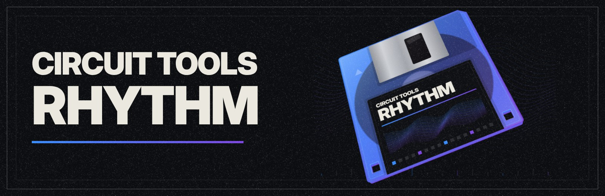

Thousands of samples with names that say nothing, and only 128 slots and 228 seconds per pack. This tool measures every sample, tells you what it is and why, lets you decide with one key, and builds packs that fit.

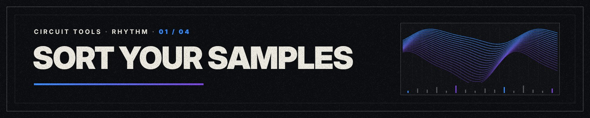

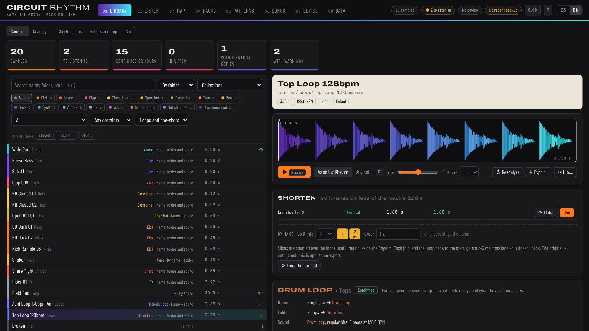

- Every sample is measured (length, pitch, tempo, brightness, attack, stereo…) and given one of 15 categories **with the reason**: what the name says, what the folder says and what it sounds like. Contradictions are shown, not hidden.
- **One sample, one folder.** What plays and the type (loop or one-shot) decide where it goes: one-shots to their instrument (`04 Closed-Hats`), loops to `14 Drum Loops` or `15 Melodic Loops` with what plays inside (`Closed-Hats`, `Perc`, `Bass`…). The card shows exactly where the sample will be saved.
- Your own subfolders and tags, word filters, saved filters, a collection map and similar sounds. Your original files are never touched.

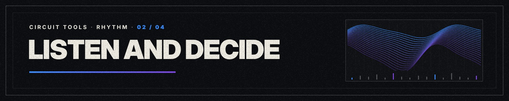

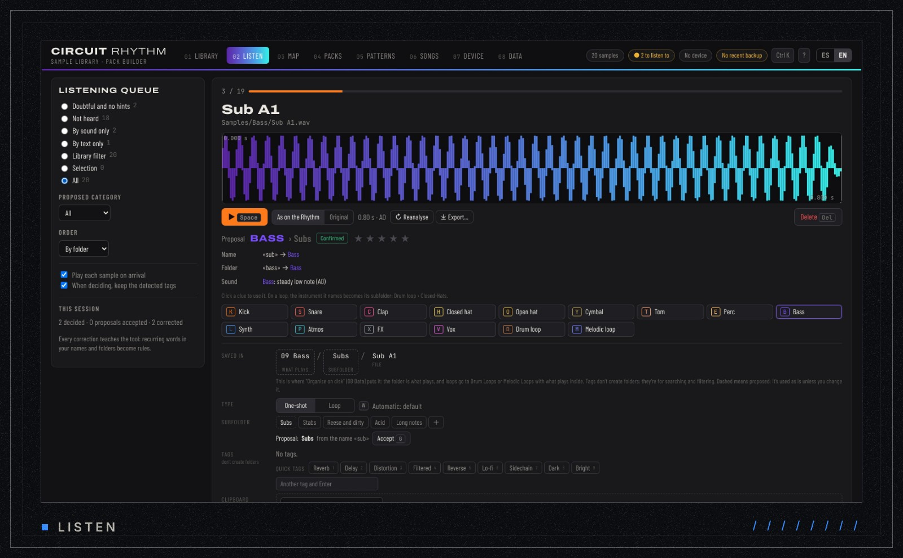

- One key per category, and the next sample plays. W switches loop / one-shot and the sample moves with it.
- Click any detected clue to use it. Copy a sample's category, type, subfolder and tags and paste them on the next ones (Alt Shift V / Alt V).
- Del sends a sample to the bin and Ctrl Z brings it back.

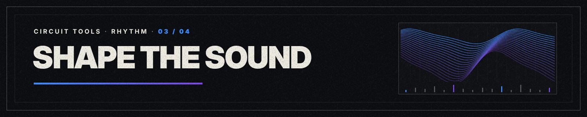

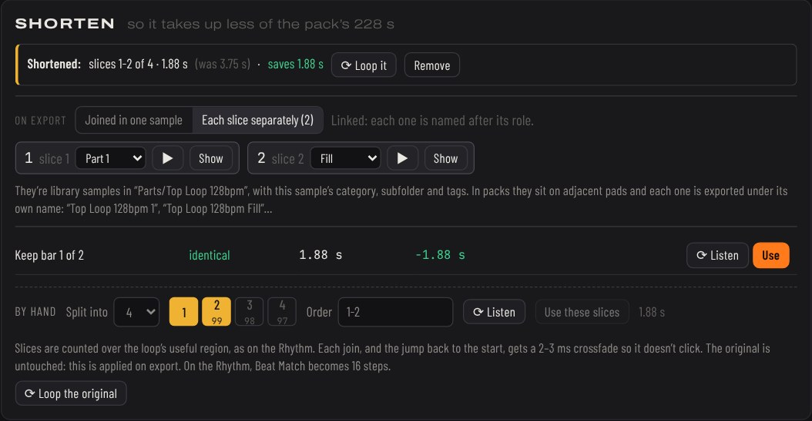

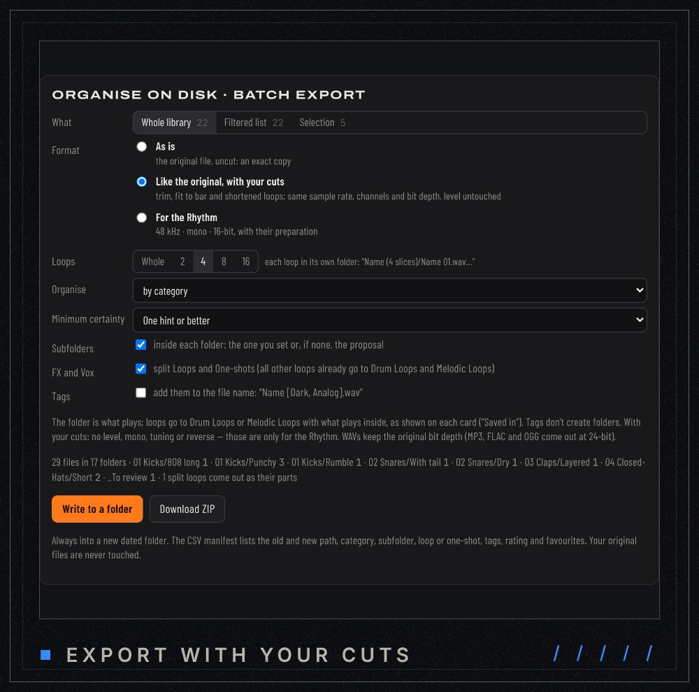

Nothing here changes your files: it's a recipe applied on export.

- **Hits from a loop**: every hit found, cleanly cut and classified; repeated hits are grouped so you keep the best one.
- **Shorten loops** that repeat, and export the slices you keep joined or as separate, linked samples (the loop and the loop with the fill, side by side in the pack).
- **Mono that repairs**: if a stereo sample cancels when summed, it's fixed (inverted channel, channels a few ms apart, or a frequency-aligned sum). Your file and anything exported "as the original" stay in stereo.
- Tune everything to the key of the pack, and match perceived loudness (LUFS) page by page.
- **Batch export** of the library, the filtered list or a selection, sorted into folders: as is, like the original with your cuts (same sample rate, channels and bit depth), or for the Rhythm. Loops can come out in 2–16 slices.

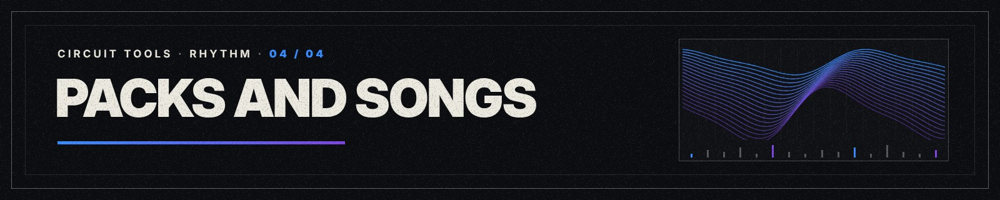

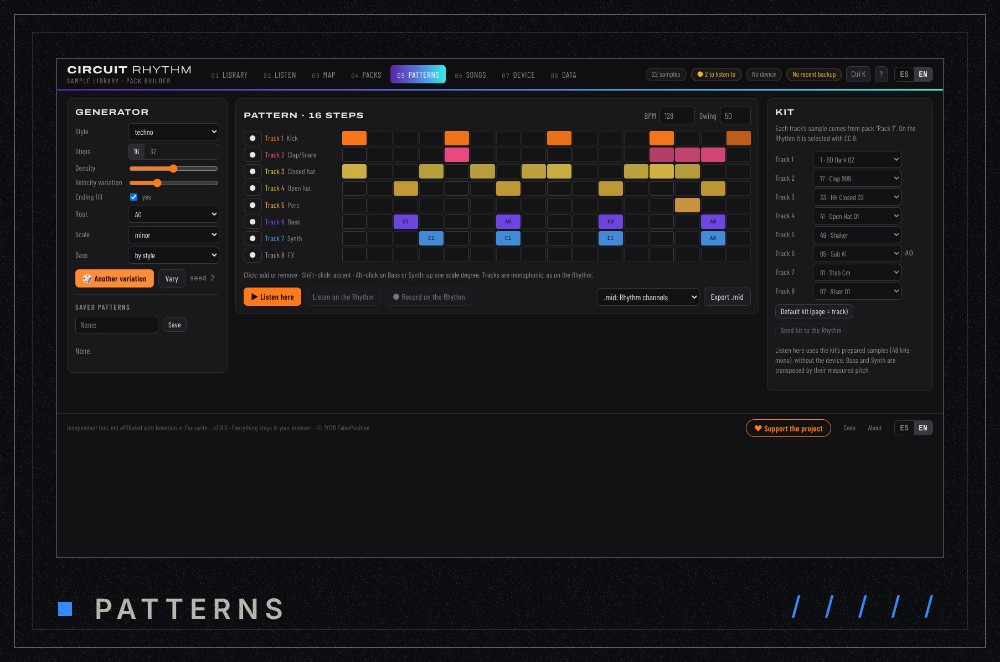
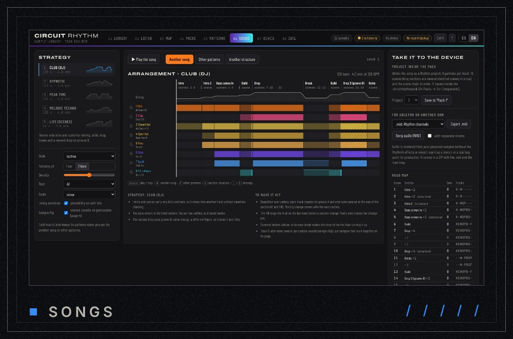

- 8 pages × 16 pads, the 228-second budget always in view, Beat Match per loop, automatic build without duplicates.
- Export for Components (`.circuitrhythmpack`), straight to the microSD card, as a ZIP or as numbered WAVs.
- Pattern generator for the 8 tracks (9 styles) and a **song generator**: arrangement strategies written as a Rhythm project inside the pack, plus song .mid, WAV mix and stems.

More: [circuit-rhythm/README.md](circuit-rhythm/README.md)

---

## Circuit Tracks · Patch Library / Editor

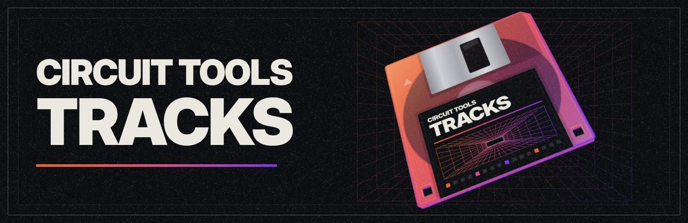

Hundreds of patches, random names, no idea how they sound. This tool reads them, explains them and plays each one on your Circuit Tracks so you decide by ear.

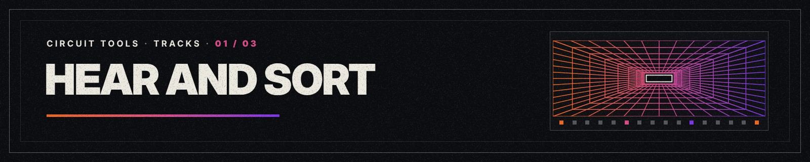

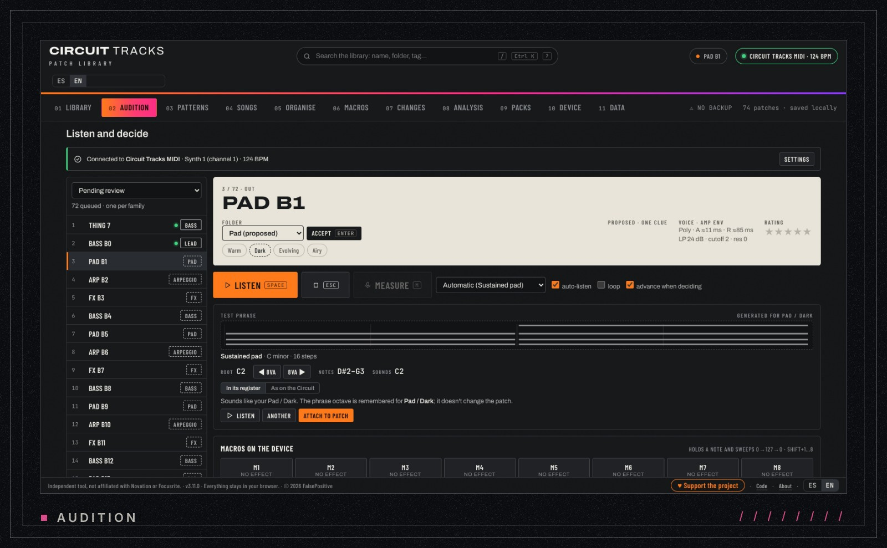

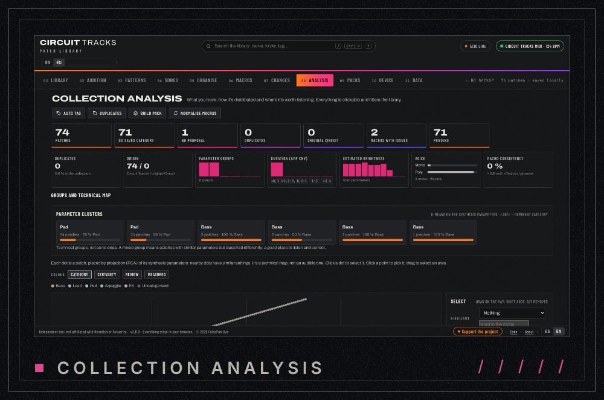
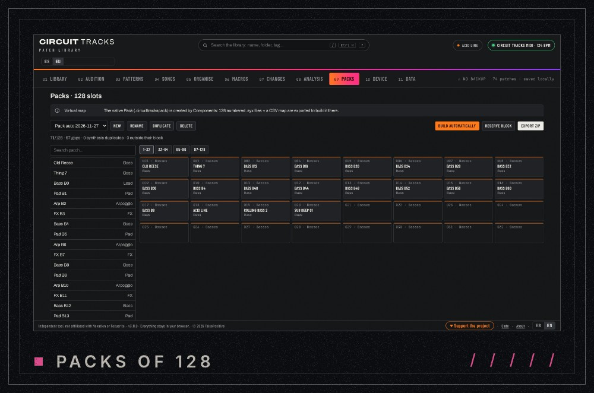

- **Audition**: every patch is sent to the unit's RAM and played with a test phrase that suits it (bassline, acid, chords, arpeggio…). Each patch sounds in its group's register, and you're told when one sits an octave away from the rest, with a one-click fix. Esc or the next patch cuts the phrase at once. < / Shift < move the phrase an octave, Alt ↓ / Alt ↑ move the patch. One key per category, or pick folder and subfolder right there.
- Copy a patch's folder and tags and paste them on the next ones (Shift V / V). Each patch shows the exact folder and file name *Sort on disk* will give it.
- Explainable classification from the name, the folder, the synth settings and, optionally, a measurement through your audio interface. Folders, subfolders and quick tags.
- Families of duplicates and variants, collection analysis and map. Packs of 128 sorted into the four pages of Patch View, exported as numbered .syx + CSV for Components.

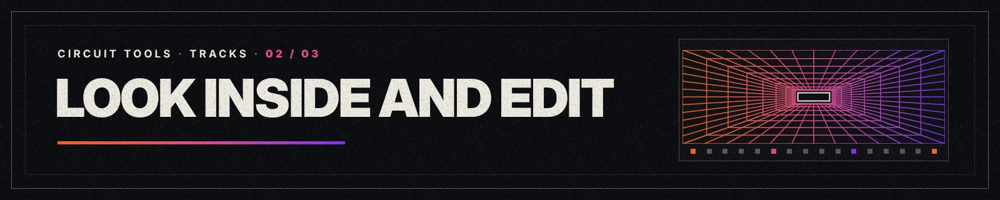

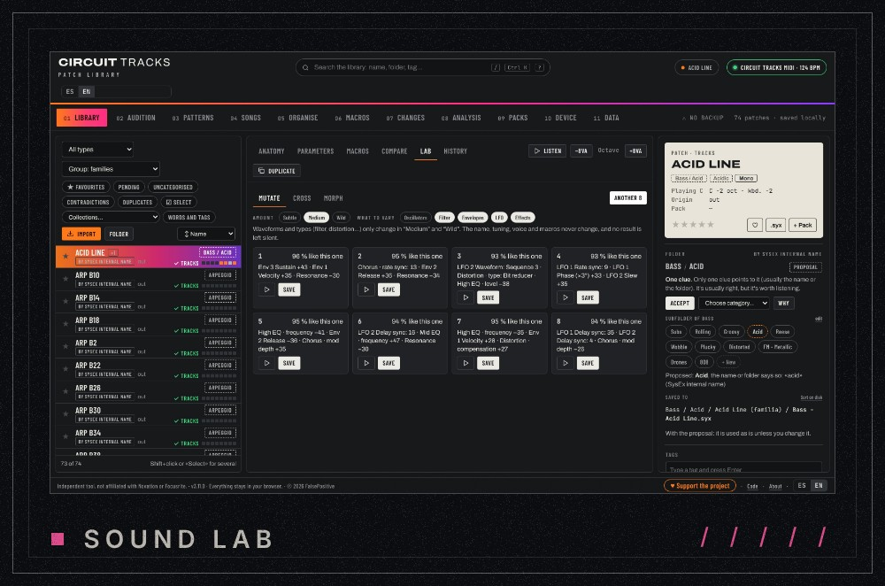

- **Anatomy**: the signal flow of every patch; click a block to edit it, and a plain-language recipe generated from the bytes.
- **Macros**: what each knob moves, turned live on the unit. Templates for all 8 macros.
- **Sound Lab**: mutate (8 variations per click), cross two patches block by block, or morph from A to B live.
- **One sound, one version**: what you edit adds up in a single version per sound (the one that plays and gets exported); the original is always kept and one click takes you back. Nothing is written to the unit's flash.

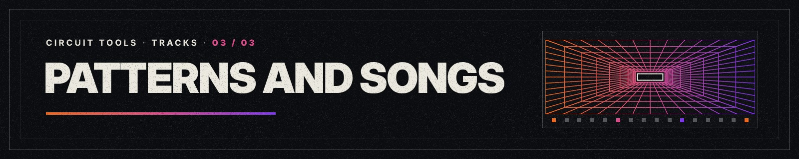

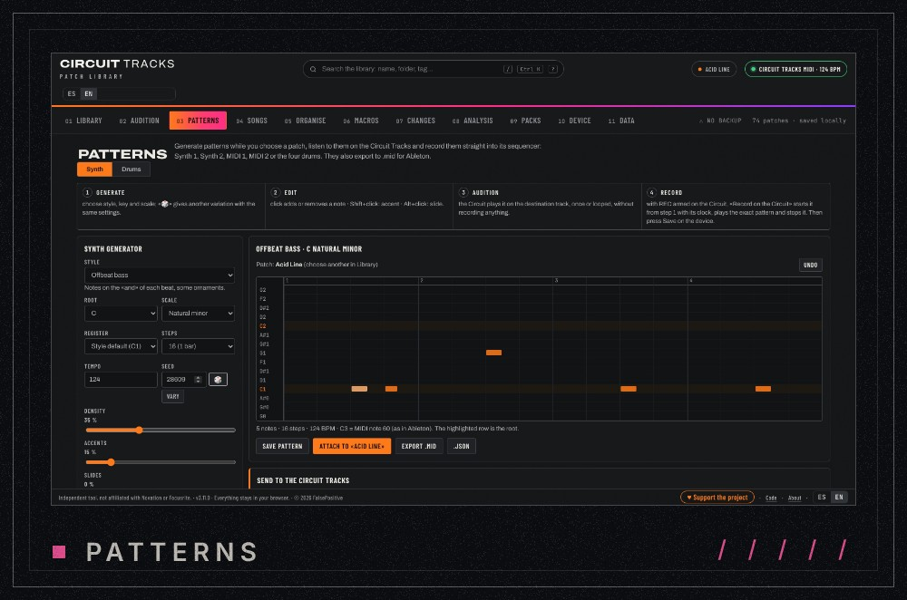

- Pattern generator recorded into the sequencer with the tool as master clock.
- Song generator with arrangement strategies, a scene plan and a guided recording, plus the song as .mid.

More: [circuit-tracks/README.md](circuit-tracks/README.md)

---

> ### ♥ Support the project
> These tools are free and will stay free. If they save you time or end up in your music, you can keep them going:
>
> - **[Buy me a coffee on Ko-fi](https://ko-fi.com/falsepositive)**: it pays for the hours of testing on real hardware.
> - **[Report a bug or suggest an idea](../../issues)**: tell me your unit, firmware and browser, and what you expected.
> - **Share it** with other Circuit users, or show what you made with it.
>
> *Apoya el proyecto: [Ko-fi](https://ko-fi.com/falsepositive) · [errores e ideas](../../issues) · compártelo.*

## Getting started

1. Download the HTML file of the tool in your language (links at the top). On the file's page, use the download button (*Download raw file*).
2. Open it in **desktop Chrome or Edge** (Web MIDI and folder access).
3. Link the folder with your samples or patches. Your library lives in your browser; back it up from *Data*.
4. To hear sounds on the unit, connect it by USB.

## Privacy

Nothing is uploaded. Your library, decisions and packs stay in your browser. The tools only send to your Circuit what you ask them to; the Circuit Tracks tool only ever writes to the unit's RAM, never to its flash memory.

## Is my copy the original?

`SHA256SUMS.txt` lists the checksum and fingerprint of every official build. The fingerprint is also shown in *About*. To inspect any copy: `node tools/marca.mjs file.html`.

## Build from source

Node 18+. In each tool folder: `npm test` and `npm run build` (outputs `dist/`). Builds are reproducible: the result matches `SHA256SUMS.txt`.

## Contributing

Bug reports and ideas are welcome in [Issues](../../issues). For a bug, include the tool and version (shown in *About*), your unit and firmware, your browser and the steps to reproduce it. Pull requests: run `npm test` in the tool folder first. If you'd rather support the work directly, there's [Ko-fi](https://ko-fi.com/falsepositive).

## Licence

© 2026 FalsePositive · GPL-3.0 (`LICENSE`). Modified versions must keep the authorship notice and publish their source under the same licence. Fonts: SIL OFL (each tool's `licenses/` and `media/fonts/`). Circuit Rhythm project template from CircuitGM, MPL-2.0 (`circuit-rhythm/third_party/circuitgm/`).

Independent project, not affiliated with Novation or Focusrite. Novation, Circuit Tracks, Circuit Rhythm and Components are trademarks of Focusrite Audio Engineering Ltd.

---

## En español

<b>Qué hace cada herramienta</b>

**Circuit Rhythm · Sample Library / Pack Builder**

- **Cada sample, explicado:** lo mide y le propone una de 15 categorías diciendo por qué (nombre, carpeta y sonido). Decides con una tecla mientras escuchas.
- **Un sample, un sitio:** lo que suena y el tipo (loop o one-shot) deciden la carpeta, y la ficha muestra dónde se guardará. Subcarpetas y etiquetas propias.
- **Un break se convierte en kit:** saca los golpes de un loop, acorta los loops que se repiten y exporta sus slices unidas o por separado.
- **Mono reparado:** los estéreos que se cancelan al sumar se arreglan para la Rhythm; tu archivo sigue en estéreo. Afina al tono del pack e iguala el volumen por página.
- **Packs que caben:** 128 pads y 228 s siempre a la vista; a Components, a la microSD, ZIP o WAV numerados. Exportar en lote tal cual, como el original con tus cortes o para la Rhythm. Generador de patrones y de canciones completas.

**Circuit Tracks · Patch Library / Editor**

- **Cada patch, en tu equipo:** lo escuchas en la Tracks (solo en la RAM) con una frase de prueba adecuada y en el registro de su grupo, viendo qué notas suenan, y decides con una tecla. Te avisa del que está una octava fuera y lo arregla con un clic.
- **La anatomía del patch:** el recorrido de la señal y una receta en lenguaje claro sacada de los bytes; macros en directo con plantillas.
- **Laboratorio de sonido:** mutar, cruzar dos patches o mezclar de A a B en directo.
- **Un sonido, una versión:** lo que editas se suma en ella y el original siempre se guarda; nada toca la memoria del equipo.
- **Patrones y canciones** grabados en el secuenciador con la herramienta como reloj maestro, y packs de 128 para Components.

**Versiones:** Rhythm 2.9 · Tracks 3.11 · [cambios](CHANGELOG.md) (en inglés).

**Colabora:** invítame a un café en [Ko-fi](https://ko-fi.com/falsepositive), cuenta errores o ideas en [Issues](../../issues) (con la versión, tu equipo, firmware y navegador) o compártelo con otros usuarios de Circuit.

**Cómo empezar:** descarga el HTML en tu idioma (en la página del archivo, botón *Download raw file*), ábrelo en Chrome o Edge de escritorio, enlaza la carpeta de tus samples o patches y conecta el equipo por USB para escuchar. Tu biblioteca se guarda en tu navegador.

