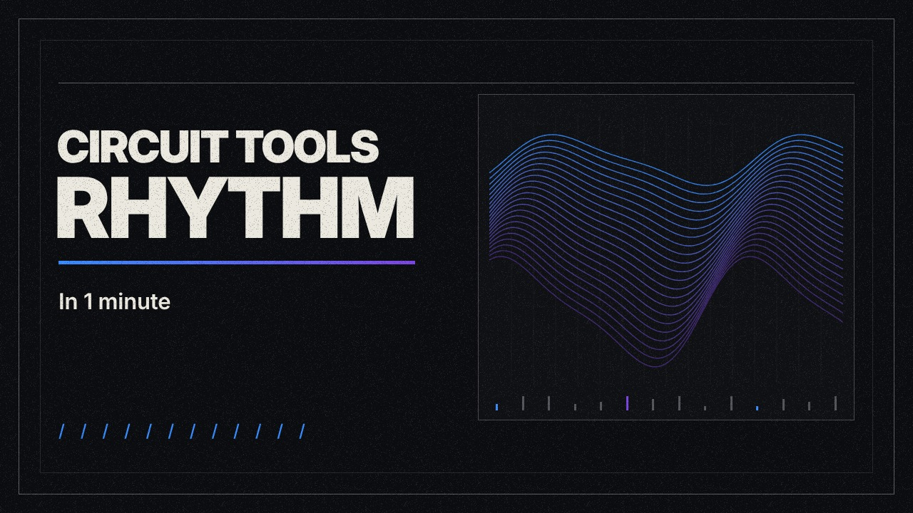
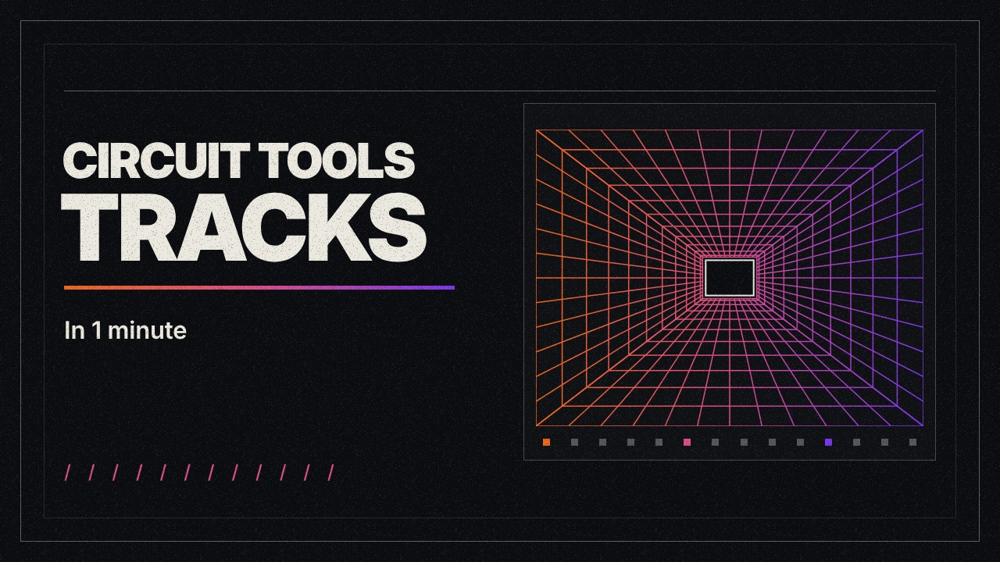
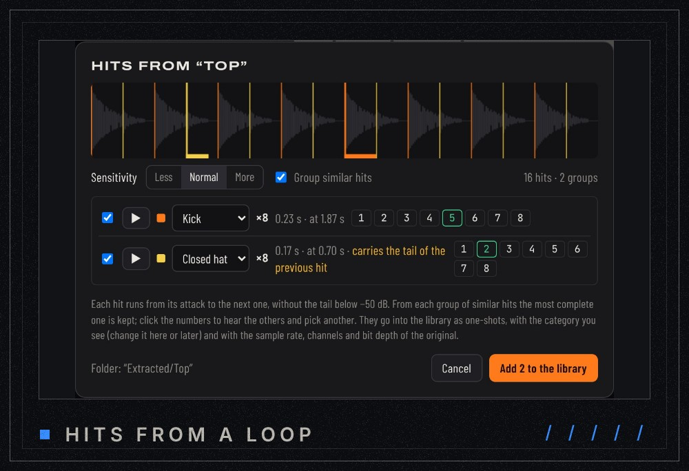
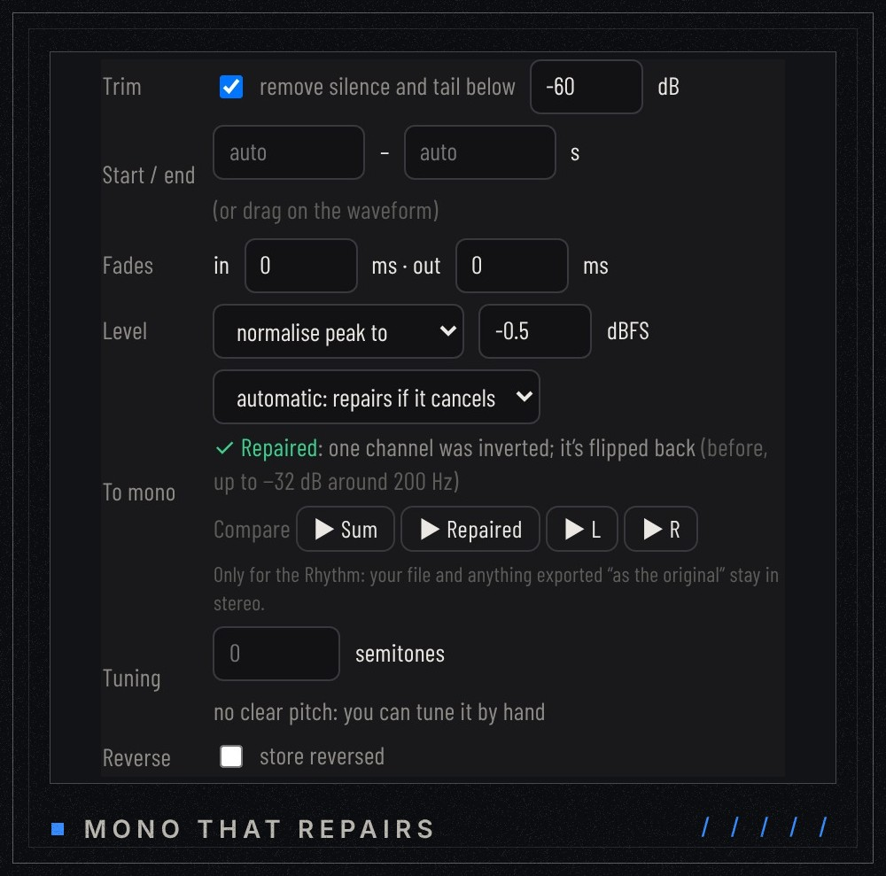
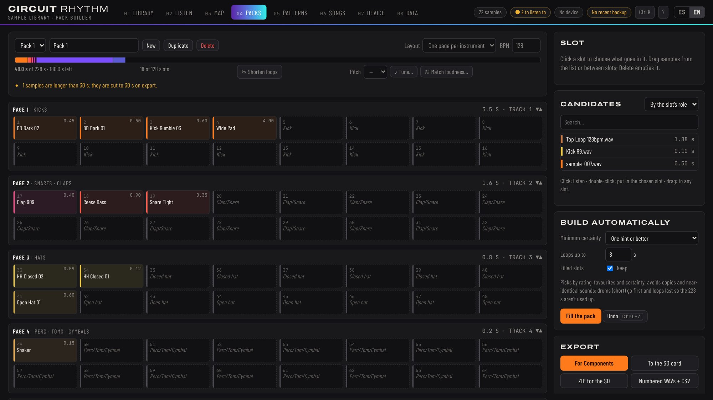
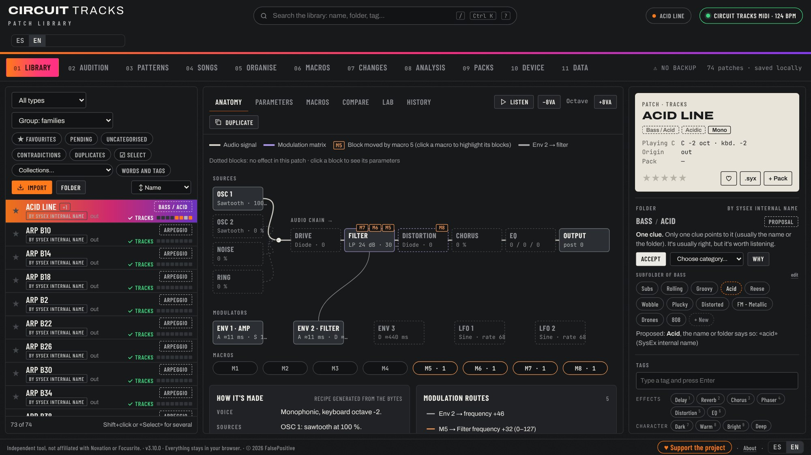
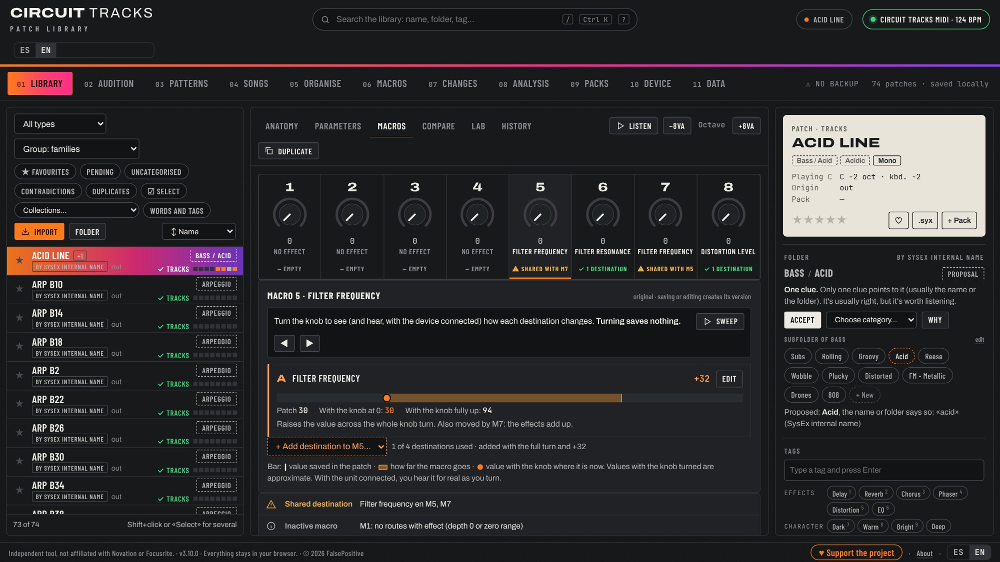
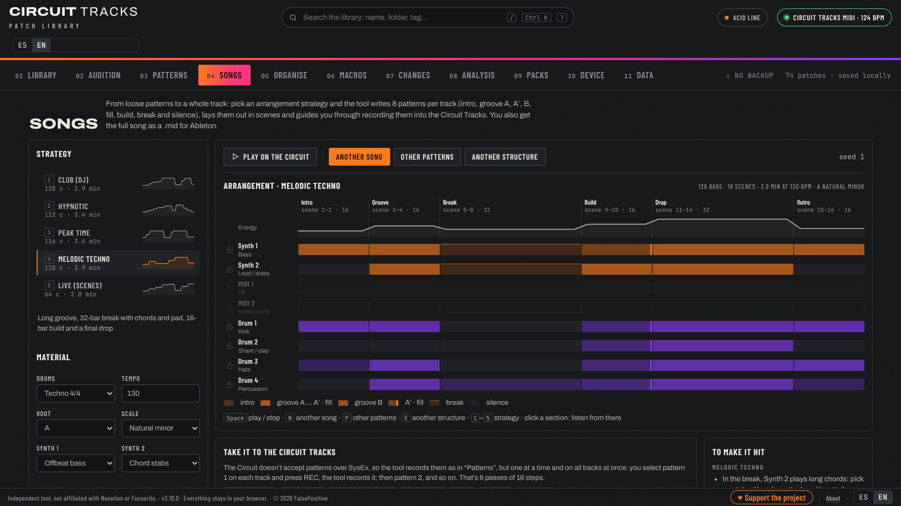

# Circuit Tools

**Free, local browser tools for the Novation Circuit Rhythm and Circuit Tracks.**
Sort a big collection, hear every sound on your own unit, fix what's wrong and build packs ready to play.
Each tool is a single HTML file: no install, no account, nothing leaves your computer.

*Herramientas gratuitas y locales para la Circuit Rhythm y la Circuit Tracks. Interfaz en español y en inglés. [Resumen en español ↓](#en-español)*

| Tool | Version | Download (ES · EN) | Video |
|---|---|---|---|
| [Circuit Rhythm · Sample Library / Pack Builder](#circuit-rhythm--sample-library--pack-builder) | 2.8.0 | [ES](circuit-rhythm/dist/Circuit_Rhythm_Sample_Library.html) · [EN](circuit-rhythm/dist/Circuit_Rhythm_Sample_Library_EN.html) | [1 min](media/circuit-rhythm-video.mp4) |
| [Circuit Tracks · Patch Library / Editor](#circuit-tracks--patch-library--editor) | 3.10.0 | [ES](circuit-tracks/dist/Circuit_Tracks_Patch_Library_Editor.html) · [EN](circuit-tracks/dist/Circuit_Tracks_Patch_Library_Editor_EN.html) | [1 min](media/circuit-tracks-video.mp4) |

| Circuit Rhythm in 1 minute | Circuit Tracks in 1 minute |
|---|---|
|  |  |

> ### ♥ Support the project
> These tools are free and will stay free. If they save you time or end up in your music, you can keep them going:
>
> - **[Buy me a coffee on Ko-fi](https://ko-fi.com/falsepositive)**: it pays for the hours of testing on real hardware.
> - **[Report a bug or suggest an idea](../../issues)**: tell me your unit, firmware and browser, and what you expected.
> - **Share it** with other Circuit users, or show what you made with it.
>
> *Apoya el proyecto: [Ko-fi](https://ko-fi.com/falsepositive) · [errores e ideas](../../issues) · compártelo.*

---

## Circuit Rhythm · Sample Library / Pack Builder

Thousands of samples with useless names, and only 128 slots and 228 seconds per pack. This tool measures every sample, tells you what it is and why, lets you decide with one key, and builds packs that fit.

**Sort your collection**

- Every sample is measured (length, pitch, tempo, brightness, attack, stereo…) and given one of 15 categories **with the reason**: what the name says, what the folder says and what it sounds like. Contradictions are shown, not hidden.
- Loop or one-shot, a subfolder (for drum loops, the instrument in it: Closed-Hats, Shakers, Breaks…) and your own tags. The card shows exactly where the sample will be saved: `14 Drum Loops / Closed-Hats / hatloop 128`.
- **Organise on disk** copies your collection into that folder structure. Your original files are never touched.

**Listen and decide**

- One key per category, and the next sample plays. Copy a sample's category, type, subfolder and tags and paste them on the next ones (Alt Shift V / Alt V).
- Click any detected clue to use it. Collection map, similar sounds, word filters, saved filters, bin with undo.

| Listen: one key per sample | Turn any break into a kit |
|---|---|
|  |  |

**Work the sound for the Rhythm** (non-destructive: a recipe applied on export)

- **Hits from a loop**: every hit found, cleanly cut and classified; repeated hits are grouped so you keep the best one.
- **Shorten loops** that repeat, and export the slices you keep **joined or as separate, linked samples** (the loop and the loop with the fill, side by side in the pack).
- **Mono that repairs**: if a stereo sample cancels when summed, it's fixed (inverted channel, channels a few ms apart, or a frequency-aligned sum). Your file and anything exported "as the original" stay in stereo.
- Tune everything to the key of the pack, and match perceived loudness (LUFS) page by page.

| Slices, joined or separate | Mono that repairs, stereo kept |
|---|---|
|  |  |

**Build packs and make music**

- 8 pages × 16 pads, the 228-second budget always in view, Beat Match per loop, automatic build without duplicates.
- Export for Components (`.circuitrhythmpack`), straight to the microSD card, as a ZIP or as numbered WAVs.
- Pattern generator for the 8 tracks (9 styles) and a **song generator**: arrangement strategies written as a Rhythm project inside the pack, plus song .mid, WAV mix and stems.

| Pack of 128 | Songs |
|---|---|
|  |  |

More: [circuit-rhythm/README.md](circuit-rhythm/README.md)

---

## Circuit Tracks · Patch Library / Editor

Hundreds of patches, random names, no idea how they sound. This tool reads them, explains them and plays each one on your Circuit Tracks so you decide by ear.

**Hear and sort**

- **Audition**: every patch is sent to the unit's RAM and played with a test phrase that suits it (bassline, acid, chords, arpeggio…). You see which notes are played and how they sound with the patch's own transposition; < / Shift < move the phrase an octave, Alt ↓ / Alt ↑ move the patch. One key per category, or pick folder and subfolder right there.
- Explainable classification from the name, the folder, the synth settings and, optionally, a measurement through your audio interface. Folders, subfolders and quick tags.
- Families of duplicates and variants, collection analysis and map.

| Audition: one key per decision | Sound Lab |
|---|---|
|  |  |

**Understand and edit**

- **Anatomy**: the signal flow of every patch; click a block to edit it, and a plain-language recipe generated from the bytes.
- **Macros**: what each knob moves, turned live on the unit. Templates for all 8 macros.
- **Sound Lab**: mutate (8 variations per click), cross two patches block by block, or morph from A to B live.
- **One sound, one version**: what you edit adds up in a single version per sound (the one that plays and gets exported); the original is always kept and one click takes you back. Bulk fixes the tool isn't sure about wait as proposals. Nothing is written to the unit's flash, ever.

| Macros | Patterns |
|---|---|
|  |  |

**Play**

- Pattern generator recorded into the sequencer with the tool as master clock, and a song generator with a scene plan and a guided recording.
- Packs of 128 sorted into the four pages of Patch View, exported as numbered .syx + CSV for Components.

| Songs | Packs |
|---|---|
|  |  |

More: [circuit-tracks/README.md](circuit-tracks/README.md)

---

## Getting started

1. Download the HTML file of the tool in your language (links above).
2. Open it in **desktop Chrome or Edge** (Web MIDI and folder access).
3. Link the folder with your samples or patches. Your library lives in your browser; back it up from *Data*.
4. To hear sounds on the unit, connect it by USB.

## Privacy

Nothing is uploaded. Your library, decisions and packs stay in your browser. The tools only send to your Circuit what you ask them to; the Circuit Tracks tool only ever writes to the unit's RAM, never to its flash memory.

## Is my copy the original?

`SHA256SUMS.txt` lists the checksum and fingerprint of every official build. The fingerprint is also shown in *About*. To inspect any copy: `node tools/marca.mjs file.html`.

## Build from source

Node 18+. In each tool folder: `npm test` and `npm run build` (outputs `dist/`). Builds are reproducible: the result matches `SHA256SUMS.txt`.

## Contributing

Bug reports and ideas are welcome in [Issues](../../issues). For a bug, include the tool and version (shown in *About*), your unit and firmware, your browser and the steps to reproduce it. Pull requests: run `npm test` in the tool folder first. If you'd rather support the work directly, there's [Ko-fi](https://ko-fi.com/falsepositive).

## Licence

© 2026 FalsePositive · GPL-3.0 (`LICENSE`). Modified versions must keep the authorship notice and publish their source under the same licence. Fonts: SIL OFL (`licenses/`). Circuit Rhythm project template from CircuitGM, MPL-2.0 (`circuit-rhythm/third_party/circuitgm/`).

Independent project, not affiliated with Novation or Focusrite. Novation, Circuit Tracks, Circuit Rhythm and Components are trademarks of Focusrite Audio Engineering Ltd.

---

## En español

<b>Qué hace cada herramienta</b>

**Circuit Rhythm · Sample Library / Pack Builder**

- Mide cada sample y le propone una de 15 categorías explicando por qué (nombre, carpeta y sonido). Decides con una tecla mientras escuchas.
- Loop o one-shot, subcarpeta (en los loops, el instrumento que suena: Closed-Hats, Shakers, Breaks…) y etiquetas. La ficha muestra la carpeta exacta donde se guardará, y «Ordenar en disco» copia tu colección así, sin tocar los originales.
- Saca los golpes de un loop, acorta loops que se repiten y exporta sus slices unidas o por separado y relacionadas, repara el mono de los estéreos que se cancelan (tu archivo sigue en estéreo), afina al tono del pack e iguala el volumen por página.
- Packs de 128 con el límite de 228 s a la vista, exportación a Components, a la microSD, ZIP o WAV numerados. Generador de patrones y de canciones completas.

**Circuit Tracks · Patch Library / Editor**

- Escucha cada patch en tu equipo (solo en la RAM) con una frase de prueba adecuada, viendo qué notas suenan, y decide con una tecla; < / Mayús < mueven la frase y Alt ↓ / Alt ↑ el patch.
- Clasificación explicada por nombre, carpeta, ajustes y medición opcional; carpetas, subcarpetas y etiquetas; familias de duplicados y variantes.
- Anatomía del patch, macros en directo y Laboratorio de sonido (mutar, cruzar, mezclar de A a B). Un sonido, una versión: lo que editas se suma en ella y el original siempre se guarda; nada toca la memoria del equipo.
- Patrones y canciones grabados en el secuenciador con la herramienta como reloj maestro, y packs de 128 para Components.

**Colabora:** invítame a un café en [Ko-fi](https://ko-fi.com/falsepositive), cuenta errores o ideas en [Issues](../../issues) (con la versión, tu equipo, firmware y navegador) o compártelo con otros usuarios de Circuit.

**Cómo empezar:** descarga el HTML en tu idioma, ábrelo en Chrome o Edge de escritorio, enlaza la carpeta de tus samples o patches y conecta el equipo por USB para escuchar. Nada sale de tu ordenador.

